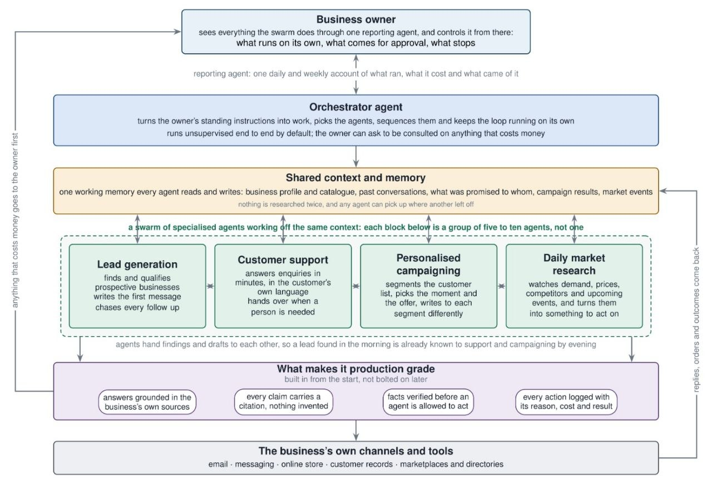
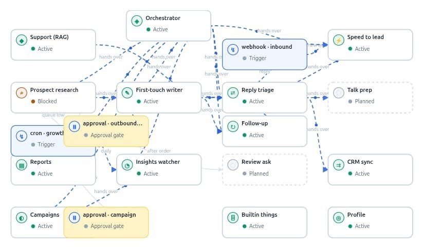
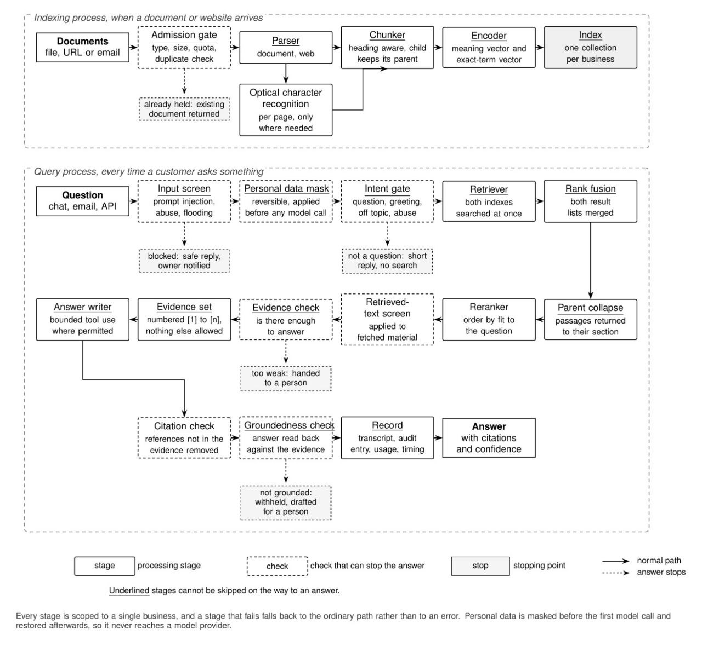

# B Swarm | Multi-Agent Sales and Support

B Swarm is a multi-tenant platform for lead research, personalized outreach, follow-ups, and customer support. A custom Python agent harness coordinates **13 implemented agents** through typed tool calls, shared business context, and scheduled jobs. Businesses can review outbound actions through configurable approval gates.



**Overall system design.** When an owner asks for outreach, the swarm uses the business profile to guide research and carries those findings into drafts, replies, and follow-ups. The tenant's policy determines which outbound actions need approval.



**The 13-agent swarm.** Agents handle work from prospect research and support through reply triage, CRM sync, and reporting. The map also shows the triggers and shared services that connect their work. Status labels are illustrative.



**Retrieval for customer support.** The agent looks up both semantic and keyword matches in the business's own sources. Qdrant ranks those results together, and the support agent uses the retrieved passages to answer with citations.

*The workflow and retrieval diagrams are design sketches. The implementation uses Qdrant collections organized by embedding model with tenant filters. Verification and privacy controls depend on policy and integrations.*

## How it works

- **Agent orchestration.** An owner can ask the orchestrator to research prospects or prepare a campaign. The harness presents registered tool schemas, limits tool rounds, and dispatches longer jobs outside the conversation.
- **Persistent workflow state.** PostgreSQL records conversation history, lead state, and procedure steps. A reply pauses pending follow-ups and routes the thread to triage. Tenant policies govern approvals, send windows, and opt-outs.
- **Hybrid retrieval.** Website and document ingestion splits material into heading-aware chunks. Qdrant combines dense embeddings and sparse keyword matches using reciprocal rank fusion. The support agent builds a bounded evidence context and checks citations.
- **Interfaces.** A React dashboard exposes sources, approvals, reports, and audit logs. External agents can reach the orchestrator over FastAPI REST, A2A, or MCP.

## Prerequisites

### Software

| What | Version | Needed for |
|---|---|---|
| Python | `>=3.12,<3.14` (`pyproject.toml`) | API, migrations, scripts |
| Postgres | 16 + `pgcrypto`, `pg_trgm` | sole datastore; extensions created by `001_tenancy.sql` (needs superuser once on managed hosts) |
| Postgres role | `NOSUPERUSER`, not table owner (`deploy/postgres-init.sql` as reference) | row-level security — supervisor bypasses tenant isolation |
| Node.js + npm | Node 22 LTS (`deploy/Dockerfile`) | dashboard build |
| Chromium (Playwright) | `playwright install chromium` | crawl engine JS rendering |
| Redis over **REST** (Upstash-compatible) | required when `GROWTH_ENABLED=true` | per-tenant send-lock leases |
| Docker Compose (optional) | Compose v2 | local PostgreSQL and Qdrant |

Hardware: single process. 2 cores / 4 GB min, 4 cores / 8 GB comfortable (Chromium peak ~1 GB). 3–5 GB disk (venv ~700 MB, Chromium ~150 MB, `node_modules` ~300 MB).

Ports used by documented run paths: `8000` API, `5173` Vite dev, `5432`/`6333`/`6379` only for the compose stack.

### Accounts / keys

Growth workflows require **PostgreSQL**, **REST Redis**, and **one LLM provider key**.

| Needed | When without it |
|---|---|
| `DATABASE_URL`, `REDIS_URL`+`REDIS_TOKEN` (REST endpoint, not `redis://`), `GEMINI_API_KEY` (or `OPENAI`/`ANTHROPIC`) + `DEFAULT_LLM_MODEL` | swarm does not start or orchestrator fails |
| `GOOGLE_CLIENT_ID`+`GOOGLE_CLIENT_SECRET` + redirect `http://localhost:8000/login` | no dashboard sign-in (Google-only; email/password removed). API-key path (REST/A2A/MCP) needs no login. |
| `TAVILY_API_KEY` (`WEB_SEARCH_BACKEND=tavily`) | research finds far fewer prospects |
| `QDRANT_URL`+key | otherwise `VECTOR_BACKEND=memory` (ephemeral, demo-only) |
| `APOLLO`/`HUNTER`, `RESEND_*`, `TELEGRAM_BOT_TOKEN`, `SHOPIFY_*`/`ZOHO_*`/`HUBSPOT_*`, `LANGFUSE_*` | optional channels/integrations; absent = gracefully skipped |

All Python deps pinned in `pyproject.toml` (`fastapi 0.118.0`, `sqlalchemy[asyncio] 2.0.43`, `asyncpg`, `crawl4ai 0.9.3`, etc). System dep: `playwright install --with-deps chromium` on Linux for `libnss3` libs.

---

## Installation

From repository root:

```bash
# 1. Python environment
python3.12 -m venv .venv
./.venv/bin/pip install -e ".[dev]"     # add [observability] for Langfuse, [mcp] for mcp/server.py

# 2. headless browser for crawl (once, ~120 MB)
./.venv/bin/playwright install chromium

# 3. dashboard dependencies
npm --prefix dashboard ci
```

Use per-environment binaries by path (`./.venv/bin/python`, `./.venv/bin/uvicorn`), not bare names.

---

## Project Setup

### 1. Database role (if not managed)

`deploy/postgres-init.sql` is the reference: create `NOSUPERUSER` role, `GRANT CONNECT`, `USAGE, CREATE ON SCHEMA public`, then set a password.

### 2. Create `.env`

```bash
cp .env.example .env
```

Set the following values for a local development run with growth workflows enabled:

```bash
ENVIRONMENT=development
DATABASE_URL=postgresql+asyncpg://app:<password>@<host>:5432/<db>

# generate each with: python -c "import secrets; print(secrets.token_urlsafe(48))"
SECRET_KEY=<random>
ENCRYPTION_KEY=<random>     # wraps tenant secrets; loss orphans them
INTERNAL_TOKEN=<random>     # for /internal/cron + /internal/jobs

GROWTH_ENABLED=true
QUEUE_BACKEND=inline
CACHE_BACKEND=redis
DEMO_LOCAL=true             # allows growth on inline queue (demo only)
LOCAL_CRON=true             # in-process ticker (no QStash here)
REDIS_URL=https://<name>.upstash.io
REDIS_TOKEN=<token>
VECTOR_BACKEND=memory       # qdrant + QDRANT_URL for production RAG
STORAGE_BACKEND=local
EMBEDDING_BACKEND=fake
PUBLIC_BASE_URL=http://localhost:8000
DASHBOARD_URL=http://localhost:5173

LLM_BACKEND=gemini
GEMINI_API_KEY=<key>
DEFAULT_LLM_MODEL=<model your provider serves>

# recommended for research quality
WEB_SEARCH_BACKEND=tavily
TAVILY_API_KEY=<key>
```

Validation at startup fails fast on bad combos: `GROWTH_ENABLED` needs `redis` cache; `qstash` queue refuses localhost `PUBLIC_BASE_URL`; `LOCAL_CRON`/`DEMO_LOCAL`/`memory`/`fake` are refused when `ENVIRONMENT=production`.

### 3. Apply migrations

```bash
./.venv/bin/python -m scripts.migrate
```

27 ordered files `migrations/001_tenancy.sql` … `027_telegram_channel.sql` (four no-op stubs `014,015,023,025` preserve numbering after billing/widget removal). Runner is idempotent, ledgered in `schema_migrations`. Managed Postgres: create `pgcrypto`/`pg_trgm` as superuser before first run.

### 4. Seed a local tenant

```bash
./.venv/bin/python -m scripts.seed
```

Creates `demo` tenant + owner + default agent + one website source parked at review gate, then prints `sk_live_…` **once** (stored hashed, unrecoverable). Copy it — it is the credential for REST/A2A/MCP with no login required. Idempotent if `demo` already exists. Override source: `DEMO_SEED_URL=https://… ./…/python -m scripts.seed`.

### 5. Google OAuth for dashboard (only if using the UI)

1. Google Cloud Console → OAuth client (Web application).
2. Add `http://localhost:8000/login` as redirect URI (= `GOOGLE_REDIRECT_URI`), and `http://localhost:5173` as JS origin.
3. Add `GOOGLE_CLIENT_ID`/`GOOGLE_CLIENT_SECRET` to `.env`, restart the API.
4. First sign-in auto-provisions tenant + owner + default agent.

For the swarm alone, the API key from `seed` is enough; no browser needed.

### 6. Dataset / data placement

No dataset ships; none required. The knowledge base is built at runtime from tenant material:

| Source | Ingest | Stored at |
|---|---|---|
| Uploads (PDF/DOCX/XLSX/PPTX, scanned OCR) | dashboard `/knowledge` or `POST /v1/documents` | object storage `tenants/{id}/documents/{id}` |
| Website crawl | `POST /v1/sources/website` or seeded source | same bucket |

With `STORAGE_BACKEND=local` the bucket is `LOCAL_STORAGE_DIR` (`./data/storage`, git-ignored). Derived vectors live in Qdrant or process memory (`memory` lost on restart; `POST /v1/documents/{id}/reindex` rebuilds).

---

## Execution

### API and dashboard

```bash
# T1 — API (default :8000)
./.venv/bin/uvicorn app.api.main:app

# T2 — dashboard (proxies /v1,/a2a,/health to :8000)
npm --prefix dashboard run dev
# build instead: npm --prefix dashboard run build → dashboard/dist served at /app

# T3 — verify
curl -s http://localhost:8000/health     # {"status":"ok"}
curl -s http://localhost:8000/ready      # {"database":"ok"}
```

Open http://localhost:5173, sign in with Google (see setup §5). API serves built SPA at http://localhost:8000/app. One backend process only (`LOCAL_CRON` assumes single writer; no `--reload` for long demos).

### Local database and vector store with Docker

```bash
docker compose -f deploy/docker-compose.yml up -d postgres qdrant
```

Use the local PostgreSQL owner for migrations and the non-owner application role for the API. To use the local vector store, set `VECTOR_BACKEND=qdrant` and `QDRANT_URL=http://localhost:6333` when running the API on the host. Growth workflows use a Redis REST endpoint configured in `.env`.

## Deployment

Use [deploy/Dockerfile](deploy/Dockerfile) to build the API and dashboard image from the repository root. Deployment configuration is available for [Fly.io](deploy/fly.toml) and [systemd](deploy/kado.service). Apply the database migrations with an owner role before running the API with its restricted application role.

For production, configure PostgreSQL, durable storage, real embeddings, Qdrant, Redis REST, and QStash. Store credentials in the deployment environment. Point `PUBLIC_BASE_URL` to the service origin and register recurring jobs with [deploy/qstash-schedules.sh](deploy/qstash-schedules.sh).

```bash
# Set QSTASH_TOKEN, INTERNAL_TOKEN, and PUBLIC_BASE_URL in the environment first.
bash deploy/qstash-schedules.sh
```

## API examples

**Health**
```bash
curl -s localhost:8000/health  # {"status":"ok"}
```

**Public A2A agent card**
```bash
curl -s localhost:8000/.well-known/agent-card.json | jq '{url, defaultAgent, skills: (.skills|length), agents: (.agents|length)}'
# url → PUBLIC_BASE_URL + /v1/orchestrator/ask, defaultAgent orchestrator
```

**Ask the orchestrator with a tenant API key**
```bash
curl -s localhost:8000/v1/orchestrator/ask \
  -H "Authorization: Bearer sk_live_…" -H "Content-Type: application/json" \
  -d '{"question":"how many leads do we have and what is queued?"}' | jq .
# {"answer":"… grounded in tenant rows …","conversation_id":null}
```

**Ask over A2A**
```bash
curl -s localhost:8000/a2a/message/send \
  -H "Authorization: Bearer sk_live_…" -H "Content-Type: application/json" \
  -d '{"jsonrpc":"2.0","id":"1","method":"message/send","params":{"message":{"role":"user","parts":[{"kind":"text","text":"queue a research run for 5 leads"}]}}}' | jq .
# result.kind task, status.state completed
```

**Dashboard** at http://localhost:5173 after Google sign-in: `/visualise` (agent graph), `/growth/settings` (profile/window/caps), `/growth/approvals` (HITL inbox), `/growth/reports`, `/audit`, `/agents` sources.

**Troubleshooting:** `address already in use` → `pkill -f 'uvicorn app.api.main'`; startup validation exit → read `validate_runtime` message (usually `GROWTH_ENABLED`+`memory`/`inline` without `DEMO_LOCAL`); `/ready` fail → `DATABASE_URL`/extensions.

---

## Repository layout

| Path | Purpose |
|---|---|
| [`app/`](app/) | FastAPI, agent harness, retrieval, operations, and integrations |
| [`dashboard/`](dashboard/) | React and TypeScript dashboard |
| [`migrations/`](migrations/) | Ordered PostgreSQL schema migrations |
| [`scripts/`](scripts/) | Migration runner and local tenant seeding |
| [`mcp/`](mcp/) | MCP stdio server |
| [`deploy/`](deploy/) | Container build, deployment configuration, and scheduled jobs |
| [`assets/`](assets/) | Agent, workflow, and retrieval diagrams |
